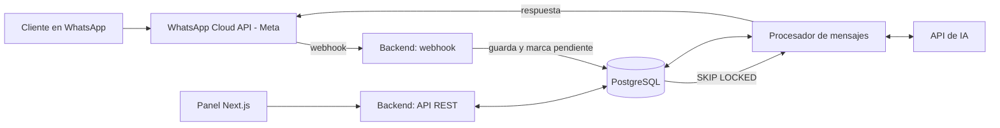
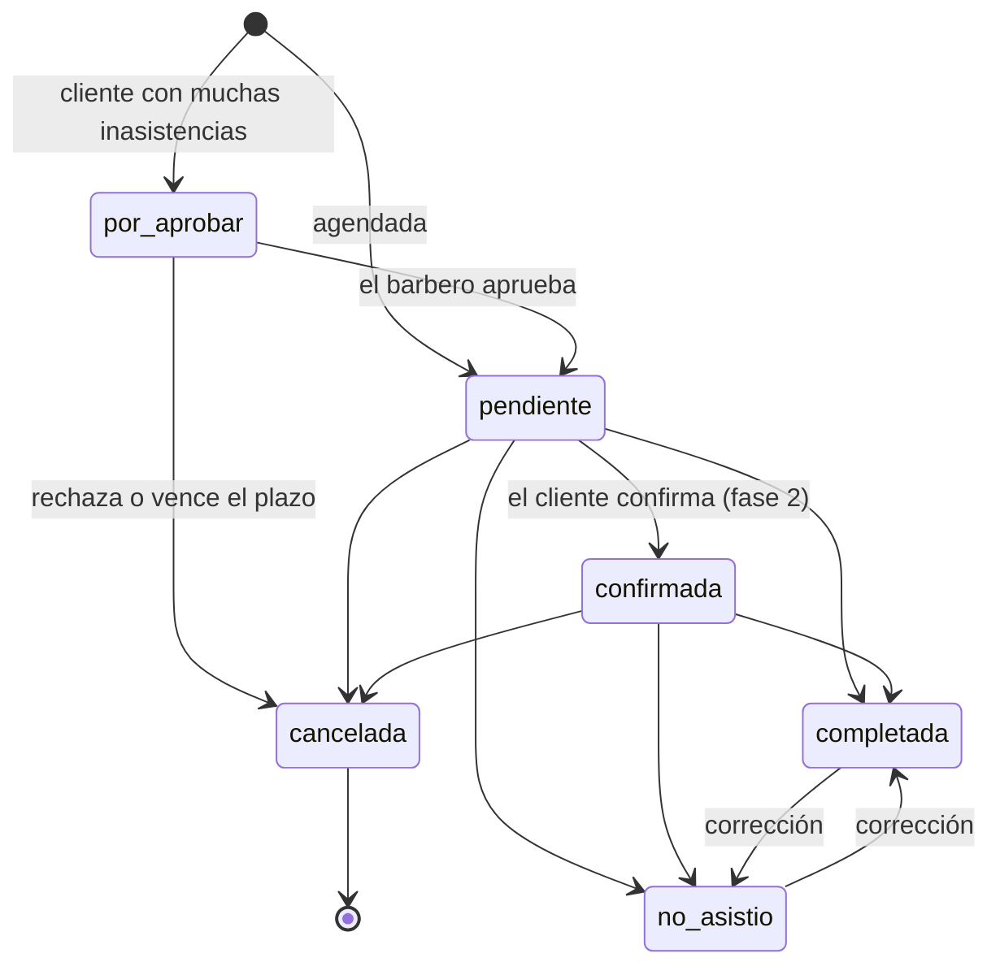

# Arquitectura de Turnoo

Este documento explica **qué hace el sistema y por qué está diseñado así**. Si algo cambia en una decisión importante, se actualiza aquí en el mismo commit.

## 1. Qué problema resuelve

Las barberías pierden clientes por no contestar a tiempo y llevan las citas en cuadernos o en el chat. Turnoo atiende el WhatsApp del negocio con una IA que responde dudas y agenda citas sin dobles reservas, y le da al negocio un panel para ver su agenda.

Dos tipos de negocio objetivo:

- **Barbería de barrio:** uno o pocos barberos, el cliente escribe al número del negocio. En el sistema es un negocio con un solo profesional, y la IA agenda directo sin preguntar con quién.
- **Barbería consolidada:** varios barberos y un número de recepción. La IA hace de recepcionista: el cliente elige barbero o se asigna uno libre.

## 2. Roles

| Rol | Qué puede hacer |
|---|---|
| `superadmin` | Crear negocios, asignar planes, ver el uso, registrar pagos y suspender cuentas. No pertenece a ningún negocio. |
| `dueno` | Ver y gestionar todo su negocio: barberos, servicios, horarios, citas, conocimiento de la IA y configuración. |
| `empleado` | Ver su propia agenda y gestionar sus propios servicios, horario y bloqueos. |

## 3. Decisiones de producto

| Tema | Decisión |
|---|---|
| Modelo | SaaS multi-negocio (meta: más de 5 negocios). |
| WhatsApp | API oficial de WhatsApp Cloud. Un número por negocio. El modelo permite también un número por barbero (`whatsapp_cuentas.profesional_id`), pero no se implementa en el MVP. |
| Sedes | Una sola por negocio por ahora; el modelo ya tiene sedes. |
| Agenda | Cada barbero define su propio horario de trabajo (varios rangos por día) y puede marcar días libres o bloqueos. Si un bloqueo o un cambio de horario choca con citas, se guarda y se listan las citas afectadas para que el negocio decida; no se cancelan solas. |
| Servicios | Cada barbero registra los suyos, con su duración y precio. |
| Cita | Una persona por cita, con uno o varios servicios del mismo barbero; la duración total es la suma. El cliente puede agendar varias citas seguidas. |
| Datos del cliente | Nombre, teléfono (viene de WhatsApp), hora, servicios y notas libres. |
| Intervalo y límites | Configurables por negocio: intervalo de citas (15 min por defecto), anticipación mínima (1 h) y máxima (30 días), máximo de citas activas por cliente (2). |
| Cancelar o reprogramar | El cliente lo hace por WhatsApp hasta un límite de horas antes (configurable, 2 h por defecto). El negocio puede siempre desde el panel y se avisa al cliente con plantilla. |
| Recordatorio | Uno solo, unas 10-12 horas antes (11 h por defecto), con plantilla de WhatsApp. No se envía de noche (07:00 a 21:00 por defecto). |
| IA | Solo habla de temas del negocio, usando su base de conocimiento. Si no sabe, deriva a una persona; no inventa. Proveedor: OpenAI, con el modelo en una variable de entorno. Antes de agendar confirma con el cliente el día, la hora, el barbero y los servicios. |
| Audios | Se transcriben; si no se puede, se pide al cliente que escriba. |
| Imágenes | Se guardan y se adjuntan a la cita como referencia; la conversación sigue normal. |
| Derivación a humano | La conversación pasa a `humano`, la IA calla y se avisa al dueño por WhatsApp. Vuelve sola a la IA a las 2 horas. En el MVP no hay bandeja de chats: la persona contacta al cliente por fuera. |
| Inasistencias | El barbero marca "no asistió" con un toque; si no marca nada en 24 horas, la cita se completa sola. Con 3 inasistencias en 30 días, las citas nuevas del cliente pasan a `por_aprobar`. |
| Aprobación | Una cita `por_aprobar` reserva el hueco. El barbero tiene 2 horas para responder (sin pasar de 1 hora antes de la cita); si no, se libera y se avisa al cliente. Las inasistencias son por negocio, no se comparten. |
| Datos personales | Aviso de tratamiento de datos en el primer mensaje, que nombra a Meta y a OpenAI. Ese primer mensaje no pasa por la IA. Se entiende aceptado cuando el cliente vuelve a escribir, y solo entonces se guarda fecha y versión en `consentimientos`. |
| Cobro a negocios | Mensualidad por cantidad de barberos o de citas. Prueba de 15 días. En el MVP el cobro es manual y se registra en `pagos`. |
| Usuarios | Un empleado se invita con su barbero asignado. Desactivar corta el acceso de inmediato. Solo una invitación activa a un usuario; la recuperación de contraseña nunca lo hace. Nadie puede desactivar al último dueño activo. |
| Barberos | Se desactivan, no se borran, y no se puede mientras tengan citas futuras. Un dueño que atiende se asocia a un barbero igual que un empleado. El plan limita los barberos activos. |
| Negocio suspendido | Puede iniciar sesión y consultar, pero no modificar nada. El superadmin lo suspende a mano y puede ayudarle a recuperar el acceso. |
| Costos | La mensualidad cubre los mensajes de WhatsApp, la IA y la transcripción. Cada plan tiene límites de barberos, citas al mes y conversaciones de IA al mes. |
| Panel | Roles `dueno` y `empleado`. Bandeja de chats en la fase 2. |

## 4. Componentes



- **Webhook:** valida la firma de Meta, guarda el mensaje, marca la conversación como pendiente y responde 200.
- **Procesador de mensajes:** corre dentro de la API. Toma las conversaciones pendientes con `SKIP LOCKED`, de a una por conversación y en orden, espera 5 segundos desde el último mensaje para responder todo junto, llama a la IA y envía la respuesta. No usa pg-boss.
- **API REST:** atiende al panel.
- **Tareas programadas:** recordatorios, expiración de citas por aprobar, autocompletado de citas y avisos de derivación. El regreso de una conversación a la IA no es una tarea: se evalúa cuando llega el siguiente mensaje (sección 7).

## 5. Aislamiento entre negocios

Es la garantía más importante del sistema: ningún negocio puede ver ni tocar datos de otro, ni siquiera por un error de código.

1. **Toda tabla de negocio lleva `negocio_id`.**
2. **Row Level Security (RLS)** activo y forzado: la base filtra por `negocio_id` según la variable de sesión `app.negocio_id`.
3. **Claves foráneas compuestas** `(negocio_id, id)`: la base impide referenciar una fila de otro negocio.
4. **La aplicación se conecta con el rol `turnoo_app`**, que no es superusuario y no puede saltarse el RLS.

Cada transacción de negocio empieza así (lo hace un único ayudante en el código, ver CONVENCIONES):

```sql
BEGIN;
SELECT set_config('app.negocio_id', '<uuid del negocio>', true);
-- ... consultas ...
COMMIT;
```

Tareas internas y superadmin usan `set_config('app.es_sistema', 'true', true)`.

Solo dos consultas ocurren antes de conocer el negocio, y son funciones con `SECURITY DEFINER` que devuelven lo mínimo:

- `fn_buscar_cuenta_whatsapp(phone_number_id)`: a qué negocio pertenece un webhook.
- `fn_usuario_para_login(email)`: datos para iniciar sesión.

## 6. Modelo de datos

Migraciones en `db/migrations/`. Resumen por áreas:

| Área | Tablas |
|---|---|
| Plataforma | `planes`, `negocios`, `configuracion_negocio`, `uso_mensual`, `pagos` |
| Acceso | `usuarios`, `tokens_usuario`, `sesiones` |
| Operación | `sedes`, `profesionales`, `horarios_trabajo`, `bloqueos`, `servicios` |
| Citas | `clientes`, `citas`, `cita_servicios` |
| WhatsApp e IA | `whatsapp_cuentas`, `conversaciones`, `mensajes`, `conocimiento`, `derivaciones` |
| Legal | `consentimientos` |

Garantías que da la propia base de datos:

- **Sin citas dobles:** una restricción de exclusión impide que un barbero tenga dos citas activas (`por_aprobar`, `pendiente`, `confirmada`) que se solapen, aunque dos clientes pidan a la vez.
- **Sin servicios cruzados:** todos los servicios de una cita deben ser del mismo barbero de la cita.
- **Sin mensajes duplicados:** `mensajes.wa_message_id` es único; si Meta reenvía un webhook, el segundo se ignora.
- **Estados válidos:** un trigger rechaza transiciones de cita no permitidas.
- **Horarios coherentes:** un barbero no puede tener dos rangos de trabajo que se crucen el mismo día.

Convenciones del modelo: tiempos de cita en `timestamptz` (UTC); horarios de trabajo en hora local del negocio (`time`, con `negocios.zona_horaria`); dinero en pesos colombianos enteros; estados con `CHECK` y no `ENUM`.

## 7. Estados

### Cita



`cancelada` es final. Reprogramar cambia `inicio` y `fin` de la misma cita y reinicia el recordatorio.

### Conversación

- `bot`: la IA responde.
- `humano`: la IA calla. Pasa a `humano` al derivar (queda `humano_desde`) y vuelve a `bot` sola pasadas `horas_modo_humano` (se evalúa cuando llega el siguiente mensaje).
- `cerrada`: reservado para la bandeja de la fase 2.

## 8. Recorrido de un mensaje entrante

1. Meta llama al webhook. Se verifica la firma `X-Hub-Signature-256` sobre el cuerpo sin procesar. Se guarda el mensaje (pasos 2 y 3) y luego se responde 200, de modo que si la base falla Meta lo reenvía. Hoy el recorrido llega hasta el paso 3 y el regreso del modo humano; lo demás se construye con el envío de mensajes y la IA.
2. `fn_buscar_cuenta_whatsapp` identifica el negocio. Si está suspendido, se ignora. Se abre la transacción con su contexto.
3. Se guarda el mensaje (`ON CONFLICT (wa_message_id) DO NOTHING`; si ya existía, se detiene) y se busca o crea el cliente y la conversación. El cliente se reconoce primero por su BSUID (`from_user_id`, que Meta envía siempre) y luego por su teléfono, que puede no llegar si la persona activó su nombre de usuario de WhatsApp. Un mismo teléfono con otro BSUID es otra persona (número reciclado) y recibe un cliente nuevo.
4. Si el cliente aún no recibió el aviso de tratamiento de datos de la versión vigente, se le envía después de responder 200 a Meta, y el mensaje no pasa a la IA. El consentimiento se registra cuando el cliente vuelve a escribir: así lo decidió Juan José (se entiende aceptado al seguir conversando), y registrarlo al enviar el aviso afirmaría algo que aún no ocurrió.
5. Si la conversación está en `humano` (y no ha vencido), la IA no interviene. Si se alcanzó el límite del plan, se deriva con motivo `limite_plan`.
6. Si es audio, se descarga y transcribe; si es imagen, se guarda.
7. Se llama a la IA con las reglas, la información del negocio, la fecha y hora local, el historial reciente y sus funciones.
8. Se envía la respuesta, se guarda como mensaje saliente y se suman los tokens a `uso_mensual`.

## 9. La IA y sus funciones

Funciones disponibles para la IA: `listar_profesionales_y_servicios`, `consultar_disponibilidad`, `crear_cita`, `listar_mis_citas`, `cancelar_cita`, `reprogramar_cita` y `derivar_a_humano`.

Reglas de seguridad (no negociables):

- **El negocio y el cliente los pone el backend, nunca la IA.** Aunque un cliente intente engañar al modelo, no puede ver ni modificar citas de otros.
- **La IA no inventa horarios:** la disponibilidad la calcula el código (horario del barbero, menos bloqueos, menos citas activas, según la duración total, el intervalo y la anticipación mínima y máxima).
- **Toda función se valida en el servidor** (horarios, límites, plazos de cancelación, límites del plan), no en la IA.
- **Choques de agenda:** si dos personas piden el mismo hueco, la base rechaza la segunda (error `23P01`) y la IA ofrece otras opciones.
- **Si la respuesta no está en la información del negocio, deriva.** Es preferible una derivación a una promesa falsa.
- Cada derivación guarda su motivo y lo que preguntó el cliente, para completar la base de conocimiento cada semana.

## 10. Tareas programadas

| Tarea | Qué hace |
|---|---|
| Recordatorios | Envía la plantilla de recordatorio según `horas_recordatorio`, respetando el horario permitido. |
| Aprobaciones vencidas | Pasa a `cancelada` las citas `por_aprobar` cuyo plazo venció, con `cancelada_por = 'sistema'`. El aviso al cliente queda pendiente hasta el webhook. |
| Autocompletar | Pasa a `completada` las citas pasadas que nadie marcó, pasadas `horas_autocompletar_cita`. |
| Limpieza | Borra las filas vencidas de `intentos_login`. |
| Avisos de derivación | Envía al dueño el aviso por WhatsApp (plantilla) cuando la IA deriva. |

Aprobaciones vencidas, autocompletar y limpieza ya corren, con un temporizador dentro de la API (`backend/src/tareas/`). Las demás dependen del webhook.

## 11. Costos y límites por plan

- Las respuestas de la IA dentro de la ventana de 24 horas de WhatsApp no tienen costo de mensaje.
- Los recordatorios y avisos al dueño casi siempre salen fuera de esa ventana, por lo que son **plantillas de utilidad con costo**.
- La IA y la transcripción de audio se pagan por uso.
- `uso_mensual` cuenta citas, conversaciones de IA, plantillas, segundos de audio y tokens por negocio, para aplicar los límites y calcular el costo real.
- Al 80% del límite se avisa al dueño; al 100% la IA deja de responder y deriva.

## 12. Seguridad y datos personales

- Los secretos viven solo en `.env` (nunca en Git). El token de Meta se guarda cifrado en la base; la clave de cifrado vive fuera de ella.
- Contraseñas con hash argon2; tokens de sesión, invitación y recuperación guardados solo como hash.
- La base de datos no se expone a internet: solo la ven los otros contenedores.
- Copias de seguridad diarias fuera del servidor, y probar la restauración.
- Ley 1581 de 2012 (Colombia): política de tratamiento de datos, registro de la autorización en `consentimientos` y anonimización (`clientes.anonimizado_en`) cuando alguien pida borrar sus datos: se quitan nombre, teléfono y notas, y se borran sus conversaciones. Las citas se conservan sin datos personales.
- No registrar en los logs el contenido de los mensajes ni los teléfonos completos.

## 13. Pendientes por decidir

- Planes: nombres, precios y límites concretos.
- Cómo se factura WhatsApp a Meta para que lo pague Turnoo (por defecto Meta le cobra al dueño de cada cuenta) y cómo se da de alta cada negocio (manual al inicio).
- Servicio de transcripción de audio. El proveedor de IA ya está decidido (OpenAI); el modelo exacto se elige con las conversaciones de prueba.
- Servicio de envío de correos (invitaciones y recuperación de contraseña).
- Política de retención de mensajes y audios.
- Revisión legal del texto de autorización de datos y de la política de tratamiento.
- Aspectos tributarios y de facturación al cobrar la mensualidad.
- Licencia del repositorio.
